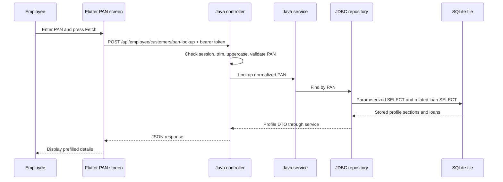

# SQLite PAN lookup: setup and client walkthrough

The employee PAN screen uses a real, file-backed SQLite database through the Java backend. The three bundled customer profiles are synthetic demonstration records, not a government PAN or credit bureau service. Entering a PAN retrieves an existing profile; it cannot discover details for a PAN that has never been stored.

## Start on Windows

From the project root, with Java 21 installed:

```powershell
.\scripts\start-employee.ps1
```

The script selects the standalone `EmployeePortal` Java entry point and the `local` profile. It uses the project's downloaded Maven if available, otherwise Maven from PATH. First-time dependency downloads require internet access. Keep the terminal open.

The default database is `backend/.data/employee-demo.sqlite`. SQLite needs no separate database server, database account, password, or port. The Java process needs read/write permission on the database directory. Startup creates missing directories and tables, then inserts missing demo customer IDs in a transaction. Existing customer IDs are left unchanged on restart. The JSON resource is only a startup seed; Fetch reads SQLite.

To use another database file or API port:

```powershell
.\scripts\start-employee.ps1 -DatabasePath 'C:\demo-data\pan.sqlite' -Port 8081
```

Alternatively set `EMPLOYEE_DATABASE` before starting Java. `app.employee-database` in `backend/src/main/resources/application.yml` maps that environment variable to the file path. Relative paths resolve from the Java working directory; the script always starts in `backend`.

For Maven installed on PATH, the equivalent command from `backend` is:

```powershell
mvn '-Dapp.main-class=com.ingrowwth.homeloan.EmployeePortal' '-Dspring-boot.run.arguments=--spring.profiles.active=local' spring-boot:run
```

The separate default `HomeFinance` entry point retains the older borrower application's H2/PostgreSQL configuration. Use `EmployeePortal` for this SQLite demonstration.

## Connect the existing Flutter app

From `mobile`, choose the API address for your device:

```powershell
# Android emulator
flutter run --dart-define=API_BASE_URL=http://10.0.2.2:8080
# Windows or browser on the same computer
flutter run -d windows --dart-define=API_BASE_URL=http://127.0.0.1:8080
```

Use the employee login mobile `8200229099` and demo OTP `123456`, open the PAN details screen, enter one of these PANs, and press Fetch:

| PAN | Customer |
|---|---|
| QWERT1234L | Saurav Kumar Patel |
| PLMNO5678K | Priya Sharma |
| ZXCVB9012M | Rahul Mehta |

The local backend binds to loopback. A physical phone needs a reachable backend address and an intentional network binding configuration; the emulator uses its host alias above. The employee service uses `API_BASE_URL`, not the legacy borrower's `API_URL` setting.

## Architecture



The controller returns 400 for invalid PAN format, 401 for a missing/expired session, 404 for an unknown PAN, and 500 if the database lookup fails. There is no fabricated profile fallback. Session tokens expire after 30 minutes and are cleared when Java restarts.

## Database configuration and tables

| Setting | Value |
|---|---|
| Engine | SQLite through Xerial sqlite-jdbc 3.46.1.0 |
| Java connection | `jdbc:sqlite:<absolute database path>` |
| Schema | `backend/src/main/resources/employee/schema.sql` |
| Seed source | `backend/src/main/resources/employee/customers.json` |
| Foreign keys | Enabled on every connection |
| Lock wait | `PRAGMA busy_timeout=5000` (5 seconds) |
| Startup writes | Transaction, rollback on failure |
| Lookup | JDBC prepared statements, unique PAN index |
| Database files in Git | Excluded by `.data/` ignore rule |

| Table | Purpose and relationships |
|---|---|
| customers | Primary customer ID and basic profile JSON |
| customer_pans | One row per customer; unique PAN and PAN section JSON |
| customer_addresses | One address section per customer |
| customer_employment | One employment section per customer |
| customer_credit_profiles | One simulated credit section per customer |
| customer_loans | Zero or more loan JSON rows per customer; indexed customer ID |

All child tables reference `customers.customer_id`. Profile fields are stored as JSON text within relational sections; this is not a separate SQL column for every screen field. The PAN column supplies the indexed lookup. JPA and Flyway are excluded in the standalone portal; its repository runs the SQLite schema directly. Schema changes to existing tables need an explicit migration; `CREATE TABLE IF NOT EXISTS` does not alter them.

## Show the client the actual database

Open `backend/.data/employee-demo.sqlite` in a SQLite desktop viewer such as DB Browser for SQLite. Refresh the viewer after updates. The file is already present in this workspace and startup also creates it on a clean checkout.

Run these read-only queries in the viewer:

```sql
SELECT sqlite_version();
SELECT name, sql FROM sqlite_master WHERE type IN ('table', 'index');
SELECT c.customer_id, p.pan_number, c.basic_json
FROM customers c JOIN customer_pans p ON p.customer_id = c.customer_id;
PRAGMA integrity_check;
PRAGMA foreign_key_check;
```

To demonstrate that Fetch reads persisted SQLite data, edit a synthetic record's `basic_json` using the viewer while retaining valid JSON and the existing keys. Commit the change, press Fetch again, restart Java, and fetch again: the stored change remains. Keep a backup before editing.

To preload additional demo profiles, add a complete new customer with a unique customer ID and PAN to `employee/customers.json`, preserving the existing structure, then restart Java. Existing IDs are intentionally skipped, so edit existing stored records in SQLite. There is currently no customer-edit/import API.

## API demonstration without Flutter

Run in another PowerShell terminal after startup:

```powershell
$session = Invoke-RestMethod -Method Post -Uri 'http://127.0.0.1:8080/api/employee/demo-session' -ContentType 'application/json' -Body '{"mobile":"8200229099","otp":"123456"}'
$headers = @{ Authorization = "Bearer $($session.token)" }
Invoke-RestMethod -Method Post -Uri 'http://127.0.0.1:8080/api/employee/customers/pan-lookup' -Headers $headers -ContentType 'application/json' -Body '{"panNumber":"QWERT1234L"}' | ConvertTo-Json -Depth 20
Invoke-RestMethod 'http://127.0.0.1:8080/api/health'
```

The response includes basic, PAN, address, employment, simulated credit, and home-loan sections. Backend logs include the request ID and masked PAN for tracing the request.

## Verification and operating scope

`EmployeeControllerTest` covers all seeded PANs, normalization, invalid/unknown inputs, authentication, database file persistence, relationships, uniqueness and foreign-key constraints. It also changes an actual stored row, reopens the repository, checks the HTTP response uses that changed row, and restores the original row.

Run `mvn test` from `backend` to execute the Java tests. Flutter API and screen tests are in `mobile/test/employee_profile_test.dart`.

Verified on 1 November 2026: all 12 Java tests and all 4 Flutter PAN tests passed. A running `EmployeePortal` on port 8082 returned all three stored customers through authenticated HTTP requests, and `/api/health` reported database `UP`. Flutter rendering was checked through widget tests with mocked HTTP; a manual device walkthrough was not performed in this session.

This employee portal is a local client demonstration with fixed demo credentials and synthetic records. The SQLite file has no built-in encryption configured. Real customer data needs production authentication, appropriate access controls, protected storage/backups, and an approved data source. SQLite is suitable for this single-backend demonstration; multiple independent application hosts should not share this file as a replacement for a server database.
